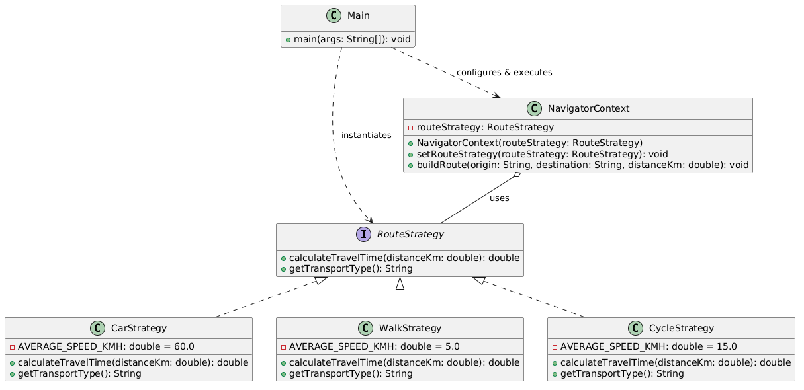

# Assignment #5 Report: Strategy Pattern

- **Course:** Software Design Patterns 
- **Student:** Kozlov Nikolay
- **Group:** SE2529
---

## 1. Introduction
The chosen domain for this assignment is **Navigation / Route Planning** (Option A). 
The application calculates estimated travel times for a given route depending on the mode of transport selected by the user. The family of algorithms includes time calculation strategies for driving a car (`CarStrategy`), walking (`WalkStrategy`), and riding a bicycle (`CycleStrategy`).

---

## 2. UML Class Diagram



*Diagram components:*
- **RouteStrategy** (Strategy Interface)
- **CarStrategy**, **WalkStrategy**, **CycleStrategy** (Concrete Strategies)
- **NavigatorContext** (Context)
- **Main** (Client)

---

## 3. Clean Code Principles Applied

### 1. Elimination of Conditional Branching (OCP & Polymorphism)
* **Before:**
```java
if (type.equals("CAR")) { time = dist / 60.0 * 60.0; }
else if (type.equals("WALK")) { time = dist / 5.0 * 60.0; }

```

* **After:**

```java
double timeMinutes = routeStrategy.calculateTravelTime(distanceKm);

```

* **Justification:** Hardcoded conditional logic is replaced with polymorphism, allowing dynamic strategy switching without modifying execution logic inside the context.

### 2. Meaningful, Intention-Revealing Names

* **Code Excerpt:** `RouteStrategy`, `CarStrategy`, `WalkStrategy`, `CycleStrategy`, `NavigatorContext`.
* **Justification:** Class and interface names clearly reflect their domain responsibilities and structural roles within the Strategy pattern.

### 3. Single Responsibility Principle (SRP)

* **Code Excerpt:** Each concrete strategy class encapsulates only its specific calculation algorithm (e.g., `WalkStrategy` only handles walking speed logic).
* **Justification:** Modifications to walking speed calculations will never affect driving or cycling strategies.

### 4. Context Algorithm-Agnosticism

* **Code Excerpt:**

```java
public class NavigatorContext {
    private RouteStrategy routeStrategy;
    // Context does not know whether strategy is Car, Walk, or Cycle
}

```

* **Justification:** `NavigatorContext` is fully decoupled from concrete implementation details of how time is computed.

### 5. Easy Extensibility (Open/Closed Principle)

* **Annotated Example:** To add `BusStrategy`, we only create a new class implementing `RouteStrategy`.
* **Justification:** Extensibility is achieved by adding new code without modifying or retesting existing classes.

---

## 4. Strategy vs. State Pattern

While both Strategy and State patterns rely on composition and delegate execution to an interface, their core intent differs:

* **Strategy:** Algorithms are interchangeable, independent, and unaware of each other. The client explicitly selects and injects the appropriate algorithm into the context to complete a task.
* **State:** States represent internal conditions of a context (e.g., Order status: Draft -> Paid -> Shipped). States often hold references to the context and trigger transitions between each other automatically based on state changes.

In this navigation scenario, **Strategy** is the correct choice because walking, driving, and cycling are alternate execution algorithms to accomplish the same operation (route calculation), rather than state transitions of the navigator.

---

## 5. Conclusion

Applying the Strategy pattern decouples the context from algorithmic details, significantly enhancing maintenance and extensibility. Although it increases the total class count (introducing an interface and separate strategy classes), this trade-off provides high flexibility, clear code isolation, and adherence to SOLID principles.

---

## 6. GitHub Repository

Link: [(https://github.com/NikolayKozlovAitu/Assignment5-StrategyPattern)]

